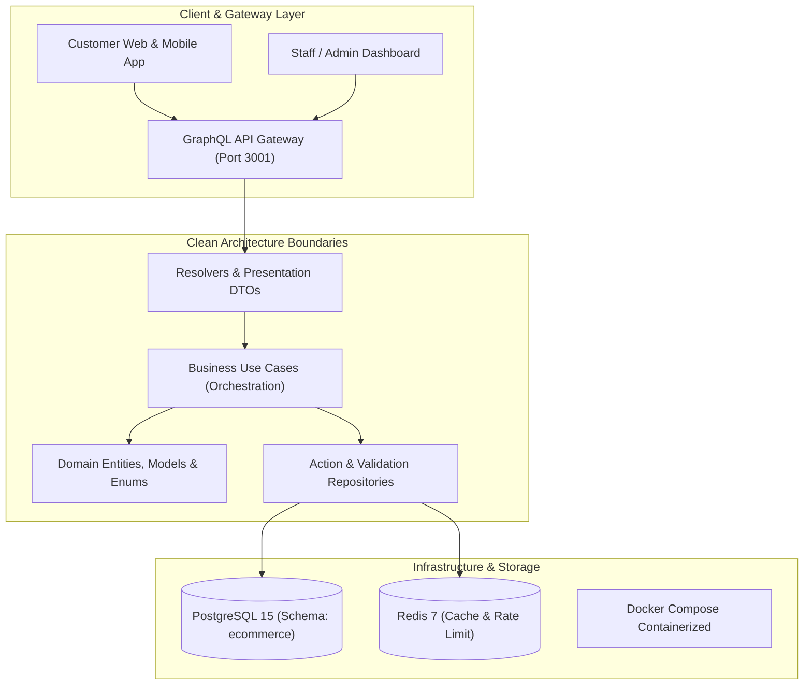
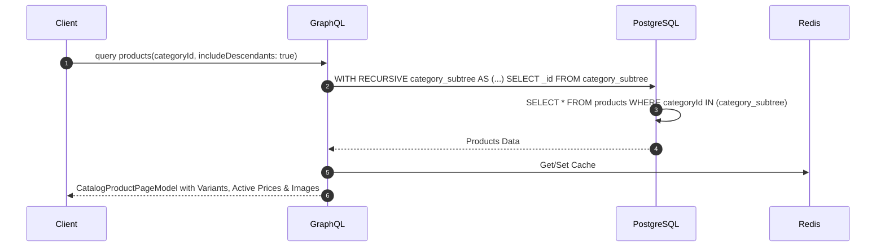
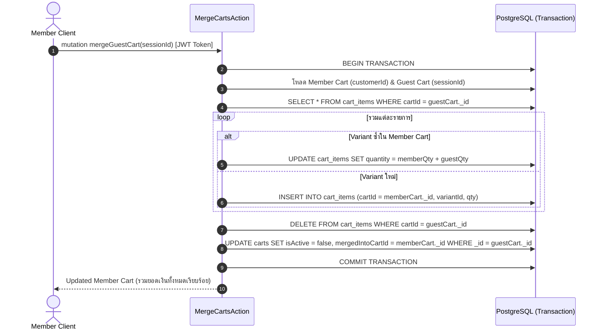
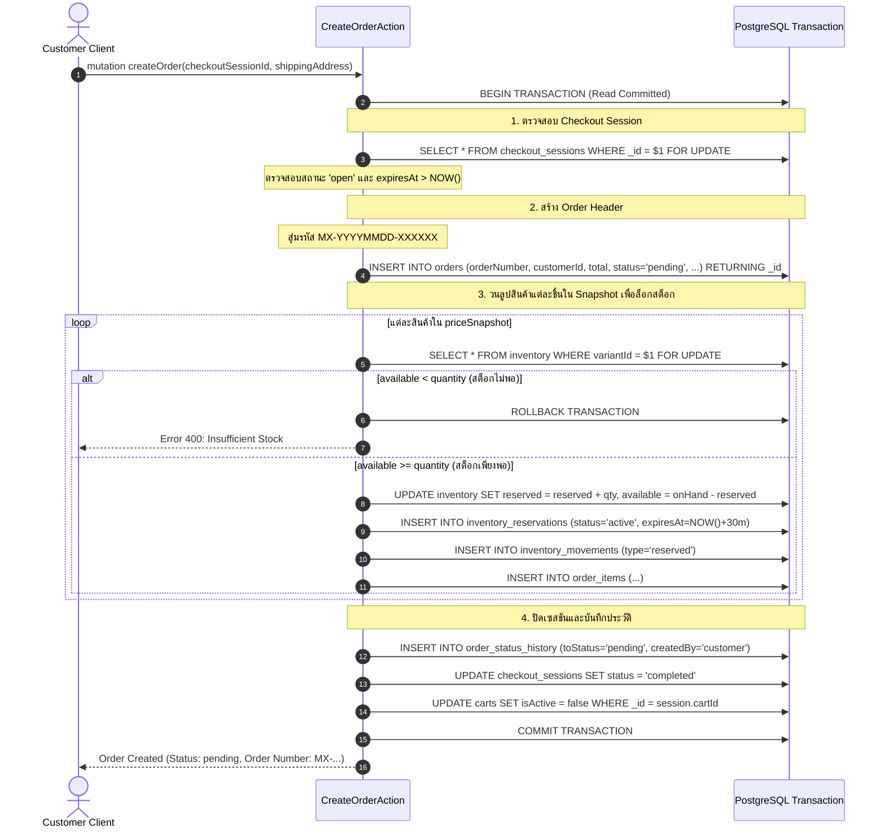

# MillionX E-commerce Backend — Full Workflow & Presentation Specification
## Phases 1, 2, and 3 Architecture, Operational Workflows & Slide Deck Blueprint

> เอกสารฉบับนี้รวบรวมรายละเอียดสถาปัตยกรรม ฐานข้อมูล ลำดับขั้นตอนการทำงาน (Workflows) กฎทางธุรกิจ (Business Rules) ไดอะแกรม (Mermaid Diagrams) และโครงร่างเนื้อหาสำหรับทำสไลด์นำเสนอ (PowerPoint Slide-Ready Blueprint) ของระบบ **MillionX E-commerce Backend** ครบทั้ง 3 Phase (Phase 1 Foundation, Phase 2 Shopping, Phase 3 Order & Inventory)

---

## 📑 สารบัญ (Table of Contents)
1. [ภาพรวมสถาปัตยกรรมทั้งระบบ (Executive System Overview)](#1-ภาพรวมสถาปัตยกรรมทั้งระบบ)
2. [🟢 Phase 1: Foundation, Catalog & Security (โครงสร้างหลัก, แคตตาล็อก และความปลอดภัย)](#2-phase-1-foundation-catalog--security)
   - [2.1 สรุปภาพรวมและจุดเด่นทางเทคนิค](#21-สรุปภาพรวมและจุดเด่นทางเทคนิค)
   - [2.2 ฐานข้อมูล 11 ตาราง (Schema `ecommerce`)](#22-ฐานข้อมูล-11-ตาราง)
   - [2.3 ลำดับขั้นตอนการทำงานแบบละเอียด (Detailed Flow 1–8)](#23-ลำดับขั้นตอนการทำงานแบบละเอียด)
3. [🟢 Phase 2: Shopping (ระบบตะกร้าสินค้า, ตรึงราคาคิดเงิน และ Wishlist)](#3-phase-2-shopping)
   - [3.1 สรุปภาพรวมและจุดเด่นทางเทคนิค](#31-สรุปภาพรวมและจุดเด่นทางเทคนิค)
   - [3.2 ฐานข้อมูล 5 ตาราง (สะสม 16 ตาราง)](#32-ฐานข้อมูล-5-ตาราง)
   - [3.3 ลำดับขั้นตอนการทำงานแบบละเอียด (Detailed Flow 1–7)](#33-ลำดับขั้นตอนการทำงานแบบละเอียด-1)
4. [🟢 Phase 3: Order & Inventory (คำสั่งซื้อ, ตัดสต็อก และป้องกันการขายเกิน)](#4-phase-3-order--inventory)
   - [4.1 สรุปภาพรวมและจุดเด่นทางเทคนิค](#41-สรุปภาพรวมและจุดเด่นทางเทคนิค)
   - [4.2 ฐานข้อมูล 6 ตาราง (สะสม 22 ตาราง)](#42-ฐานข้อมูล-6-ตาราง)
   - [4.3 ลำดับขั้นตอนการทำงานแบบละเอียด (Detailed Flow 1–6)](#43-ลำดับขั้นตอนการทำงานแบบละเอียด-2)
5. [🖥️ โครงร่างสำหรับทำสไลด์นำเสนอ (PowerPoint Slide-by-Slide Deck Blueprint)](#5-โครงร่างสำหรับทำสไลด์นำเสนอ-powerpoint-slide-deck)
6. [📊 สรุป API Contract ครบทั้ง 3 Phase](#6-สรุป-graphql-api-contract-ครบทั้ง-3-phase)

---

# 1. ภาพรวมสถาปัตยกรรมทั้งระบบ

MillionX E-commerce Backend พัฒนาด้วยสถาปัตยกรรม **Clean Architecture (Domain-Driven Design)** ร่วมกับ **NestJS Modular Architecture, GraphQL (Code-First), TypeORM (PostgreSQL), และ Redis Caching**:



### สรุปสถานะการพัฒนาทั้ง 3 Phase
| Phase | ระบบหลัก | จำนวนตาราง | ตารางสะสม | จุดเด่นสำคัญ (Key Highlights) |
| :---: | :--- | :---: | :---: | :--- |
| **Phase 1** | **Foundation & Catalog** | 11 ตาราง | 11 ตาราง | แยกบัญชีพนักงาน/ลูกค้า, Category Tree + CTE, Rate Limit, Social Login |
| **Phase 2** | **Shopping** | 5 ตาราง | 16 ตาราง | Guest & Member Cart, Atomic Merge Cart, Live Price Snapshot 30 นาที, Wishlist |
| **Phase 3** | **Order & Inventory** | 6 ตาราง | 22 ตาราง | Pessimistic Lock (`FOR UPDATE`), Anti-Overselling, Expiry Auto-Cancel, FSM |

---

# 2. Phase 1: Foundation, Catalog & Security

## 2.1 สรุปภาพรวมและจุดเด่นทางเทคนิค
* **Dual Identity Isolation:** แยกตารางระหว่างบัญชีพนักงานหลังบ้าน (`ecommerce.users`) ออกจากบัญชีลูกค้าหน้าร้าน (`ecommerce.customer_accounts`) 100% ป้องกันสิทธิ์ทับซ้อน
* **Recursive Category Tree & Cycle Protection:** หมวดหมู่สินค้าแบบต้นไม้หลายระดับ ป้องกันการเซ็ต `parentId` วนลูปกลับมาหาตัวเองด้วย PostgreSQL Trigger `prevent_category_cycle`
* **Deep Category Filtering:** ค้นหาสินค้าครอบคลุมหมวดหมู่ลูกหลานทุกระดับด้วย Recursive Common Table Expression (CTE) เมื่อส่ง `includeDescendants: true`
* **Product Bundle Creation:** บันทึกข้อมูลสินค้าหลัก, ตัวเลือกสินค้า (Variants), ข้อมูล JSONB Attributes, ราคาหลายสกุลเงิน, และรูปภาพ ใน **1 Database Transaction**
* **Brute-Force Rate Limiting:** ดักจับการล็อกอินผิดพลาดเกิน 5 ครั้ง/นาที หรือสมัครสมาชิกเกิน 3 ครั้ง/ชั่วโมง ผ่าน Redis และมี In-Memory Counter Fallback หาก Redis ขัดข้อง

---

## 2.2 ฐานข้อมูล 11 ตาราง (Schema: `ecommerce`)
1. **`users`:** บัญชี Staff/Admin (`_id`, `username`, `passwordHash`, `role`: manager/admin/staff, `status`)
2. **`zones`:** ข้อมูลพื้นที่บริการ (`_id`, `name`, `description`, `status`, `deletedAt`)
3. **`categories`:** หมวดหมู่สินค้า (`_id`, `parentId`, `name`, `slug`, `sortOrder`, `isActive`)
4. **`products`:** ข้อมูลสินค้าหลัก (`_id`, `categoryId`, `name`, `slug`, `brand`, `description`, `isActive`)
5. **`product_variants`:** ตัวเลือกสินค้า (`_id`, `productId`, `sku`, `barcode`, `name`, `attributes` jsonb, `isActive`)
6. **`product_prices`:** ราคาตามช่วงเวลาและสกุลเงิน (`_id`, `variantId`, `currency`: LAK/THB/USD, `amount`, `compareAtAmount`, `startsAt`, `endsAt`, `isActive`)
7. **`product_images`:** รูปภาพสินค้า (`_id`, `productId`, `variantId`, `url`, `altText`, `sortOrder`)
8. **`customers`:** ข้อมูลโปรไฟล์ลูกค้า (`_id`, `firstName`, `lastName`, `phone`, `email`, `isActive`)
9. **`customer_accounts`:** ข้อมูลเข้าสู่ระบบของลูกค้า (`_id`, `customerId`, `passwordHash`, `isActive`, `lastLoginAt`)
10. **`customer_social_accounts`:** ข้อมูล OAuth Social Login (`_id`, `customerId`, `provider`: GOOGLE/FACEBOOK, `providerId`, `email`)
11. **`addresses`:** สมุดที่อยู่จัดส่ง (`_id`, `customerId`, `recipientName`, `phone`, `addressLine1`, `province`, `countryCode`, `isDefault` คุมด้วย Partial Unique Index)

---

## 2.3 ลำดับขั้นตอนการทำงานแบบละเอียด (Phase 1 Workflows)

### 🔹 Flow 1.1: การลงทะเบียนลูกค้า (`registerCustomer`)
1. ตรวจสอบ Rate Limit (IP + Email/Phone ไม่เกิน 3 ครั้ง/ชม.)
2. เปิด Database Transaction
3. ตรวจสอบความซ้ำซ้อนของ `email` และ `phone` (แปลง Format เบอร์โทรเป็นสากล `+85620...` อัตโนมัติ)
4. ทำการ `INSERT INTO ecommerce.customers` เพื่อสร้าง Profile
5. แฮชรหัสผ่านด้วย `bcrypt.hash(password, 10)` แล้วทำการ `INSERT INTO ecommerce.customer_accounts`
6. Commit Transaction และสร้าง JWT Token (Access Token 15 นาที + Refresh Token 7 วัน)

### 🔹 Flow 1.2: การเข้าสู่ระบบลูกค้า (`loginCustomer`)
1. ตรวจสอบ Rate Limit (IP + Identifier ไม่เกิน 5 ครั้ง/นาที)
2. ค้นหาลูกค้าจาก Email หรือ Phone
3. ตรวจสอบ `isActive == true` ทั้งโปรไฟล์และแอคเคานต์
4. ยืนยันรหัสผ่านด้วย `bcrypt.compare` (หากผิด เพิ่ม Counter และถ้าเกิน 5 ครั้งจะบล็อกด้วย HTTP 429)
5. อัปเดต `lastLoginAt = now()` และส่งมอบคู่ JWT Access/Refresh Token

### 🔹 Flow 1.3: การเข้าสู่ระบบด้วย Social Login (`socialLoginCustomer`)
1. ตรวจสอบความถูกต้องของ Token ผ่าน Google TokenInfo API หรือ Facebook Graph API
2. ดึงข้อมูล Profile ที่ผ่านการ Verify แล้ว (`providerId`, `email`, `firstName`, `lastName`)
3. เปิด Database Transaction:
   - **กรณีผูกบัญชีอยู่แล้ว:** ดึงข้อมูลลูกค้าเดิมและอัปเดต `lastLoginAt`
   - **กรณีอีเมลตรงกับในระบบ:** เชื่อมโยง Provider เข้ากับลูกค้าเดิมอัตโนมัติ
   - **กรณีลูกค้าใหม่:** ทำการ **Auto-Register** สร้างทั้ง `customers`, `customer_accounts` (สุ่มรหัสผ่านปลอดภัย), และ `customer_social_accounts` ใน Transaction เดียว
4. Commit Transaction และออก JWT Token ให้ทันที

### 🔹 Flow 1.4: การสร้างสินค้าแบบรวมชุด (`createProductBundle`) — Staff
1. พนักงานส่งข้อมูลสินค้าพร้อม Variants, Prices, และ Images ใน Request เดียว
2. เปิด Database Transaction
3. บันทึกข้อมูลลง `products` -> นำ `productId` ไปสร้าง `product_variants` -> นำ `variantId` ไปสร้าง `product_prices` -> บันทึก `product_images`
4. ตรวจสอบเงื่อนไขราคา `compareAtAmount >= amount`
5. หากจุดใดจุดหนึ่งล้มเหลว ข้อมูลทั้งหมดจะ Rollback 100% ไม่ทิ้งข้อมูลขยะในฐานข้อมูล

### 🔹 Flow 1.5: การค้นหาสินค้าพร้อมหมวดหมู่ลูกหลาน (`products` + `includeDescendants`)


---

# 3. Phase 2: Shopping (ตะกร้า, ตรึงราคาคิดเงิน และ Wishlist)

## 3.1 สรุปภาพรวมและจุดเด่นทางเทคนิค
* **Guest & Member Cart Unified Architecture:** รองรับทั้งลูกค้าที่ยังไม่ล็อกอิน (`sessionId`) และลูกค้าที่ล็อกอินแล้ว (`customerId`) ภายใต้เอนทิตีเดียวกัน
* **Active Cart Single Guarantee:** รับประกันด้วย Partial Unique Index ว่า 1 คน หรือ 1 เบราว์เซอร์ จะมีตะกร้าที่ Active อยู่ได้ใบเดียวเท่านั้น
* **Atomic Cart Merge:** เมื่อ Guest เข้าสู่ระบบ ตะกร้า Guest จะถูกนำมารวมเข้ากับ Member Cart ใน Database Transaction เดียวกัน หากมีสินค้าซ้ำกันจะบวกเพิ่มจำนวนให้อัตโนมัติ พร้อมปิดสถานะ Guest Cart
* **Live Price Recalculation & Immutable Snapshot:** ตอน Checkout ระบบจะดึงราคาและโปรโมชันล่าสุดมาคำนวณใหม่ แล้วตรึงเป็น JSON **`priceSnapshot`** บันทึกไว้พร้อมตั้งเวลาหมดอายุ 30 นาที ป้องกันปัญหาร้านค้าเปลี่ยนราคาย้อนหลัง
* **Wishlist Dynamic MinPrice:** คำนวณราคาเริ่มต้นของสินค้าใน Wishlist แบบไดนามิกจาก Variant ที่เปิดขายอยู่ ณ ขณะนั้น

---

## 3.2 ฐานข้อมูล 5 ตาราง (สะสม 16 ตาราง)
1. **`carts`:** ตารางหัวตะกร้าสินค้า (`_id`, `customerId`, `sessionId`, `isActive`, `mergedIntoCartId`)
2. **`cart_items`:** รายการสินค้าในตะกร้า (`_id`, `cartId`, `variantId`, `quantity > 0`, `UNIQUE(cartId, variantId)`)
3. **`checkout_sessions`:** เซสชันการคิดเงิน (`_id`, `cartId`, `customerId`, `subtotal`, `discountAmount`, `shippingAmount`, `taxAmount`, `total`, `currency`, `priceSnapshot` jsonb, `status`, `expiresAt`)
4. **`wishlists`:** รายการสินค้าที่ชอบ (`_id`, `customerId` UK_FK)
5. **`wishlist_items`:** รายการสินค้าใน Wishlist (`_id`, `wishlistId`, `productId`, `UNIQUE(wishlistId, productId)`)

---

## 3.3 ลำดับขั้นตอนการทำงานแบบละเอียด (Phase 2 Workflows)

### 🔹 Flow 2.1: เพิ่มสินค้าลงตะกร้า (`addToCart`)
1. ตรวจสอบว่าสินค้า (`products`) และตัวเลือก (`product_variants`) ยังเปิดขายอยู่ (`isActive == true`)
2. ดึงตะกร้าใบเดิม หรือสร้างตะกร้าใหม่ (`GetOrCreateCartAction`)
3. ตรวจสอบใน `cart_items`:
   - หากมีสินค้านี้อยู่แล้ว: `quantity += newQuantity`
   - หากยังไม่มี: สร้างรายการใหม่ด้วย `quantity` ที่ระบุ
4. ทำการ Hydrate ตะกร้า ดึงราคาสด `unitPrice`, `compareAtPrice`, คำนวณ `lineTotal = unitPrice * quantity` และรวมเป็น `subtotal`

### 🔹 Flow 2.2: การรวมตะกร้า Guest เข้า Member (`mergeGuestCart`)


### 🔹 Flow 2.3: การคิดเงินและตรึงราคา (`createCheckoutSession`)
1. ค้นหาตะกร้าที่ Active อยู่ของลูกค้ารายนั้น (ตรวจสอบว่ามีสินค้าอย่างน้อย 1 ชิ้น)
2. สแกนราคาสินค้าแต่ละชิ้นจาก `ecommerce.product_prices` ณ วินาทีนั้น (เช็คเงื่อนไข `startsAt <= now < endsAt` และ `isActive = true`)
3. คำนวณ:
   $$\text{subtotal} = \sum(\text{unitPrice} \times \text{quantity})$$
   $$\text{total} = \text{subtotal} - \text{discountAmount} + \text{shippingAmount} + \text{taxAmount}$$
4. บันทึกข้อมูลสินค้าทั้งหมดลงใน JSON Array ชื่อ **`priceSnapshot`**
5. กำหนดเวลาหมดอายุ `expiresAt = now() + 30 นาที`
6. บันทึกลงตาราง `ecommerce.checkout_sessions` ด้วยสถานะ `open`

---

# 4. Phase 3: Order & Inventory (คำสั่งซื้อและตัดสต็อกสินค้า)

## 4.1 สรุปภาพรวมและจุดเด่นทางเทคนิค
* **Pessimistic Concurrency Locking (`SELECT ... FOR UPDATE`):** ล็อกแถวสต็อกในระดับ Database ระหว่างสร้างออเดอร์ ป้องกันปัญหา Race Condition เมื่อมีลูกค้ากดซื้อสินค้าชิ้นสุดท้ายพร้อมกันหลายคน
* **Anti-Overselling Guarantee:** หาก `available < requestedQuantity` แม้แต่รายการเดียว ระบบจะสั่ง Rollback ทันที สต็อกไม่มีวันติดลบ
* **30-Minute Temporary Reservation:** สต็อกยังอยู่ในคลัง (`onHand` คงเดิม) แต่ย้ายยอดเข้าสู่ `reserved` และลด `available` ลงทันที มีอายุการจอง 30 นาที
* **Automatic Expiry & Order Cancellation Worker:** มี Worker สแกนการจองที่หมดอายุ (>30 นาที) เพื่อคืนสต็อกกลับสู่ `available` และยกเลิก Pending Order อัตโนมัติ
* **Permanent Deduction on Fulfillment:** เมื่อออเดอร์เปลี่ยนสถานะเป็น `completed` สต็อกจะถูกตัดออกจาก `onHand` ถาวร และสถานะการจองจะกลายเป็น `consumed`
* **Comprehensive Audit Trail:** บันทึกประวัติการเปลี่ยนสถานะทุกครั้งลงใน `order_status_history` และบันทึกการเคลื่อนไหวสต็อกทุกเม็ดลงใน `inventory_movements`

---

## 4.2 ฐานข้อมูล 6 ตาราง (สะสม 22 ตาราง)
1. **`orders`:** ข้อมูลคำสั่งซื้อ (`_id`, `orderNumber` เช่น `MX-20261117-00124`, `customerId`, ยอดรวมเงิน, ข้อมูลที่อยู่จัดส่ง, สถานะออเดอร์)
2. **`order_items`:** รายการสินค้าในออเดอร์ บันทึกชื่อสินค้า, SKU, และราคาต่อหน่วย ณ ขณะซื้อ
3. **`order_status_history`:** ประวัติการเปลี่ยนสถานะ (`_id`, `orderId`, `fromStatus`, `toStatus`, `note`, `createdBy`)
4. **`inventory`:** สต็อกสินค้า (`_id`, `variantId` UK_FK, `onHand`, `reserved`, `available`)
   $$\text{available} = \text{onHand} - \text{reserved}$$
5. **`inventory_movements`:** ประวัติการเคลื่อนไหวสต็อก (`inbound`, `outbound`, `reserved`, `released`, `adjustment`)
6. **`inventory_reservations`:** การจองสต็อกชั่วคราว (`_id`, `orderId`, `variantId`, `quantity`, `status`: active/consumed/released/expired, `expiresAt`)

---

## 4.3 ลำดับขั้นตอนการทำงานแบบละเอียด (Phase 3 Workflows)

### 🔹 Flow 3.1: การสร้างคำสั่งซื้อและจองสต็อก (`createOrder`)


### 🔹 Flow 3.2: วงจรชีวิตของสถานะออเดอร์ (`updateOrderStatus`) — พนักงาน
$$\text{pending} \longrightarrow \text{confirmed} \longrightarrow \text{processing} \longrightarrow \text{completed}$$
* **เมื่อเปลี่ยนเป็น `completed`:**
  1. ดึง Reservation ที่เป็น `active` ของออเดอร์นี้
  2. หักสต็อกถาวร: `onHand = onHand - qty`, `reserved = reserved - qty`, `available = onHand - reserved`
  3. บันทึก Movement ด้วย `type = 'outbound'`
  4. ปรับสถานะ Reservation เป็น `consumed`
* **เมื่อเปลี่ยนเป็น `cancelled`:**
  1. ปลดปล่อยยอดที่จอง: `reserved = reserved - qty`, `available = onHand - reserved`
  2. บันทึก Movement ด้วย `type = 'released'`
  3. ปรับสถานะ Reservation เป็น `released`

### 🔹 Flow 3.3: การคืนสต็อกหมดอายุอัตโนมัติ (`releaseExpiredReservations`)
1. ค้นหา `inventory_reservations` ที่ `status == 'active'` และ `expiresAt < now()`
2. ปรับสถานะ Reservation เป็น `expired`
3. คืนสต็อกเข้า `inventory`: ลด `reserved` และเพิ่ม `available`
4. ตรวจสอบออเดอร์ที่เกี่ยวข้อง หากยังเป็น `pending` ระบบจะทำการ **Auto-Cancel** เป็น `cancelled` พร้อมบันทึกลง Audit Trail ทันที

---

# 5. โครงร่างสำหรับทำสไลด์นำเสนอ (PowerPoint Slide Deck)

> 💡 สามารถคัดลอกแต่ละสไลด์ด้านล่างนี้ไปวางลงในโปรแกรมทำสไลด์ (PowerPoint / Keynote / Google Slides) ได้ทันที

---

### 🖥️ Slide 1: หน้าปก (Title Slide)
* **Title:** MillionX E-commerce Backend Architecture & Core Workflows
* **Subtitle:** Deep Dive into Phase 1 (Foundation), Phase 2 (Shopping), and Phase 3 (Order & Inventory)
* **Presenter Info:** Engineering & Architecture Team
* **Key Takeaway:** ระบบ E-commerce ระดับองค์กร ออกแบบตามมาตรฐาน Clean Architecture, ฐานข้อมูล 22 ตาราง, Concurrency Lock ป้องกันการขายเกิน 100%

---

### 🖥️ Slide 2: สรุปภาพรวมความก้าวหน้าโครงการ (Executive Summary)
* **Status:** Phase 1, Phase 2, และ Phase 3 เสร็จสมบูรณ์แล้ว 100%
* **Technology Stack:** NestJS, TypeScript, GraphQL, PostgreSQL (22 Tables), Redis, Docker
* **Key Numbers:**
  - 22 ตารางฐานข้อมูลใน Schema `ecommerce`
  - 43 Bruno Automated API Requests (Pass 100%)
  - 30 Automated Unit & Contract Test Suites (Pass 100%)
  - 0% โอกาสเกิด Overselling ด้วย Pessimistic Locking

---

### 🖥️ Slide 3: แผนผัง Roadmap 5 Phases (Strategic Roadmap)
* **Phase 1: Foundation (11 Tables) — [✅ เสร็จแล้ว]** ข้อมูลสินค้า แคตตาล็อก ระบบสมาชิก และความปลอดภัย
* **Phase 2: Shopping (5 Tables) — [✅ เสร็จแล้ว]** ตะกร้าสินค้า การรวมตะกร้า ตรึงราคาคิดเงิน และ Wishlist
* **Phase 3: Order + Inventory (6 Tables) — [✅ เสร็จแล้ว]** ระบบสั่งซื้อ ล็อกสต็อกสินค้า และ State Machine
* **Phase 4: Payment + Delivery (6 Tables) — [⏳ พร้อมเริ่ม]** ชำระเงิน Webhook Idempotency และระบบขนส่ง
* **Phase 5: Growth + Control (6 Tables) — [⏹️ แผนงานถัดไป]** คูปองโปรโมชัน Outbox Event และระบบ Audit Log

---

### 🖥️ Slide 4: Phase 1 — สถาปัตยกรรมแคตตาล็อกและความปลอดภัย
* **Bullet 1: Dual Identity Isolation** — แยกตารางพนักงาน (`users`) ออกจากลูกค้า (`customer_accounts`) เด็ดขาด ป้องกันช่องโหว่การยกระดับสิทธิ์
* **Bullet 2: Auth Rate Limiter** — ป้องกัน Brute-force จำกัดล็อกอิน 5 ครั้ง/นาที ด้วย Redis (Fallback ด้วย Memory)
* **Bullet 3: Multi-Level Category Tree** — รองรับหมวดหมู่แบบต้นไม้ พร้อม Trigger ตรวจจับวงจรวนลูป
* **Bullet 4: Single-Transaction Product Bundle** — สร้าง Product + Variants + Attributes + Prices + Images จบใน 1 Transaction

---

### 🖥️ Slide 5: Phase 1 — การค้นหาสินค้าขั้นสูง (Recursive Subtree Query)
* **Challenge:** ลูกค้ากดดูหมวดหมู่ใหญ่ แต่ระบบ E-commerce ทั่วไปไม่แสดงสินค้าของหมวดหมู่ย่อย
* **Solution:** ออกแบบคำสั่ง Recursive CTE บน PostgreSQL ผ่านฟีเจอร์ `includeDescendants: true`
* **Flow:**
  1. สร้าง Temporary Subtree Hierarchy แบบ Parameterized Cycle-Safe
  2. ค้นหาสินค้าทั้งหมดที่มี `categoryId IN (category_subtree)`
  3. Hydrate ข้อมูล Variant, รูปภาพ และแปลงสกุลเงินแบบ Real-time พร้อมแคชผลลัพธ์บน Redis

---

### 🖥️ Slide 6: Phase 1 — Social Login & Auto-Registration
* **Supported Providers:** Google Sign-In & Facebook Login
* **Key Mechanism:**
  - ตรวจสอบ Token กับ Identity Provider โดยตรง
  - หากยังไม่มีบัญชี: ดำเนินการ **Auto-Register สร้าง Profile + Account + Social Link** ใน Transaction เดียว
  - ลดขั้นตอนการสมัครสมาชิก เพิ่มอัตราการเปลี่ยนเป็นลูกค้า (Conversion Rate)

---

### 🖥️ Slide 7: Phase 2 — ระบบตะกร้าสินค้าอัจฉริยะ (Guest & Member Cart)
* **Omnichannel Experience:** ลูกค้าสามารถหยิบสินค้าใส่ตะกร้าได้ทันทีแม้ยังไม่ได้เข้าสู่ระบบ (`sessionId`)
* **Active Cart Guarantee:** ควบคุมด้วย Partial Unique Index บังคับ 1 คนมีตะกร้า Active ได้ 1 ใบ
* **Live Calculation:** คำนวณ `lineTotal` และ `subtotal` จากราคาสดในฐานข้อมูลเสมอ หมดปัญหาราคาแสดงผลคลาดเคลื่อน

---

### 🖥️ Slide 8: Phase 2 — การรวมตะกร้าหลังล็อกอิน (Atomic Merge Cart)
* **User Scenario:** ลูกค้าเลือกของใส่ตะกร้าตอนเป็น Guest พอถึงหน้าจ่ายเงินจึงกด Login
* **System Action:**
  - รวมรายการจาก Guest Cart เข้า Member Cart ใน Transaction เดียว
  - รายการสินค้าซ้ำ: บวกเพิ่มจำนวน (`quantity`) อัตโนมัติ
  - รายการสินค้าใหม่: ย้ายเข้าตะกร้า Member
  - ปิดสถานะ Guest Cart ทันที ป้องกันการนำกลับมาใช้ซ้ำ

---

### 🖥️ Slide 9: Phase 2 — การตรึงราคา Checkout Session (Price Snapshot)
* **Problem:** ถ้าร้านค้าปรับราคาสินค้าระหว่างที่ลูกค้ากำลังโอนเงิน จะเกิดข้อพิพาทเรื่องราคา
* **Solution:** ออกแบบระบบ **Price Snapshot**:
  - สแกนราคาสินค้าทุกชิ้น ณ วินาทีที่กด Checkout
  - บันทึกเป็น JSON Snapshot แบบ Immutable ในตาราง `checkout_sessions`
  - กำหนดเวลาหมดอายุ 30 นาที (`expiresAt = now() + 30m`)
  - ออเดอร์ที่ถูกสร้างต่อจากนี้จะคิดเงินตาม Snapshot นี้เสมอ

---

### 🖥️ Slide 10: Phase 2 — ระบบ Wishlist และการคำนวณราคาเริ่มต้น
* **Feature:** เพิ่ม/ลบ สินค้าที่ชอบได้รวดเร็ว ป้องกันการกดซ้ำด้วย Unique Constraint
* **Dynamic MinPrice:** สแกนหา Variant ที่มีราคาต่ำสุดของสินค้านั้น ณ ปัจจุบัน แสดงผลเป็น "ราคาเริ่มต้น..."
* **Performance:** ใช้ PostgreSQL `LATERAL JOIN` ดึงราคาต่ำสุดและภาพปกสินค้าได้ใน Query เดียวโดยไม่ต้องลูปในแอปพลิเคชัน

---

### 🖥️ Slide 11: Phase 3 — การสั่งซื้อและการล็อกสต็อก (Concurrency & Anti-Overselling)
* **The Flash Sale Dilemma:** มีของชิ้นสุดท้าย 1 ชิ้น แต่มีลูกค้ากดสั่งซื้อพร้อมกัน 10 คน
* **Pessimistic Locking Solution:**
  - สั่ง `SELECT ... FROM inventory WHERE variantId = $1 FOR UPDATE`
  - ล็อกแถวสต็อกในระดับ Database ทันที
  - คนแรกผ่าน -> ปรับ `reserved = reserved + qty`, `available = onHand - reserved`
  - คนถัดมาพบ `available < requested` -> Reject ทันทีด้วย Error 400
  - สต็อกไม่ติดลบ ไม่เกิดปัญหาการขายเกิน (Zero Overselling)

---

### 🖥️ Slide 12: Phase 3 — วงจรการจองสต็อก 30 นาที และ Auto-Cancellation
* **Reservation Lifecycle:**
  - ออเดอร์สร้างเสร็จ -> สถานะ `pending` -> สต็อกถูกย้ายเข้า `reserved` (อายุ 30 นาที)
  - ลูกค้ากดยกเลิก (`cancelOrder`) -> คืนสต็อกกลับ `available` ทันที
  - เกิน 30 นาทีไม่จ่ายเงิน -> **Background Expiry Worker** กวาดคืนสต็อก และยกเลิกออเดอร์ให้อัตโนมัติ
  - ลูกค้าชำระเงินและส่งมอบ (`completed`) -> ตัดสต็อกออกจาก `onHand` ถาวร

---

### 🖥️ Slide 13: Phase 3 — ระบบบริหารจัดการสำหรับพนักงาน (Staff Management)
* **Finite State Machine (FSM):** ควบคุมสถานะอย่างเข้มงวด `pending` -> `confirmed` -> `processing` -> `completed` (ห้ามย้อนกลับ)
* **Staff Stock Adjustments:** รองรับการปรับยอดตรวจนับคลัง (`adjustment`), นำเข้า (`inbound`), และตัดจำหน่าย (`outbound`) พร้อมระบบความปลอดภัย `newOnHand >= reserved`
* **Complete Audit Trail:** ตรวจสอบย้อนกลับได้ทุก Transaction ว่าใครเป็นคนเปลี่ยนสถานะ เวลาใด และเหตุผลใด

---

### 🖥️ Slide 14: โครงสร้าง Clean Architecture และความพร้อมในการขยายระบบ
* **Folder Structure:** จัดโครงสร้าง Repository ราย CRUD Action (`action.ts` + `validation.ts`) ถอดแบบจาก `zone` ทำให้โค้ดอ่านง่าย แยกความรับผิดชอบชัดเจน (Single Responsibility Principle)
* **Microservices Ready:** Entity และ ID ทุกตัวใช้ UUID v4 สามารถแยกแต่ละ Module เป็น Microservices ได้ทันทีเมื่อธุรกิจเติบโต
* **Production Verification:** ผ่านชุดทดสอบอัตโนมัติครบถ้วนและรันงานจริงบน Docker Container

---

# 6. สรุป GraphQL API Contract ครบทั้ง 3 Phase

```text
========================================================================================
PHASE 1: FOUNDATION, CATALOG & SECURITY
========================================================================================
- Mutation: login(input: LoginDto!): LoginPayload!
- Mutation: refreshStaffToken(refreshToken: String!): RefreshTokenPayload!
- Mutation: registerCustomer(input: RegisterCustomerDto!): CustomerAuthPayload!
- Mutation: loginCustomer(input: CustomerLoginDto!): CustomerAuthPayload!
- Mutation: socialLoginCustomer(input: SocialLoginCustomerDto!): CustomerAuthPayload!
- Mutation: refreshCustomerToken(refreshToken: String!): RefreshTokenPayload!
- Query:    meCustomer: CustomerProfile!
- Query:    categories(input: LoadCategoryDto): CategoryPagination!
- Query:    products(input: LoadProductDto): ProductPagination!
- Query:    product(_id: String, slug: String): Product!
- Mutation: createProductBundle(input: CreateProductBundleDto!): Product!
- Mutation: updateProduct(input: UpdateProductDto!): Product!
- Query:    customerAddresses: [Address!]!
- Mutation: createCustomerAddress(input: CreateAddressDto!): Address!
- Mutation: setDefaultAddress(addressId: String!): Address!
- Query:    zones: [Zone!]!

========================================================================================
PHASE 2: SHOPPING (CARTS, CHECKOUT & WISHLIST)
========================================================================================
- Query:    myCart(sessionId: String): Cart!
- Mutation: addToCart(input: AddToCartDto!): Cart!
- Mutation: updateCartItem(input: UpdateCartItemDto!): Cart!
- Mutation: removeCartItem(input: RemoveCartItemDto!): Cart!
- Mutation: clearCart(cartId: String, sessionId: String): Cart!
- Mutation: mergeGuestCart(input: MergeGuestCartDto!): Cart!
- Mutation: createCheckoutSession(input: CreateCheckoutSessionDto): CheckoutSession!
- Query:    checkoutSession(_id: String!): CheckoutSession!
- Query:    myWishlist: Wishlist!
- Mutation: addToWishlist(input: AddToWishlistDto!): Wishlist!
- Mutation: removeFromWishlist(input: RemoveFromWishlistDto!): Wishlist!

========================================================================================
PHASE 3: ORDER & INVENTORY
========================================================================================
- Mutation: createOrder(input: CreateOrderDto!): Order!
- Query:    myOrders(input: LoadOrderDto): OrderPagination!
- Query:    order(_id: String!): Order!
- Query:    orderByOrderNumber(orderNumber: String!): Order!
- Mutation: cancelOrder(orderId: String!, reason: String): Order!
- Mutation: updateOrderStatus(input: UpdateOrderStatusDto!): Order!
- Query:    inventory(variantId: String!): Inventory!
- Mutation: adjustInventory(input: AdjustStockDto!): Inventory!
- Mutation: releaseExpiredReservations: Int!
========================================================================================
```
