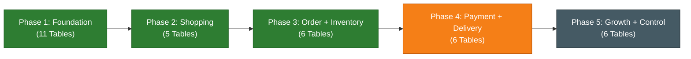

# MillionX E-commerce Backend — Full Phases Architecture & Specification

เอกสารฉบับนี้รวบรวมรายละเอียดสถาปัตยกรรม ระบบฐานข้อมูล ฟีเจอร์การทำงานหลัก กฎทางธุรกิจ (Business Rules) และแผนการทดสอบ & Deploy ของระบบ **MillionX E-commerce Backend** ครบทั้ง 5 Phase (Phase 1 ถึง Phase 5) ตามมาตรฐาน Clean Architecture (Domain → Use Cases → Infrastructure)

---

## 🗺️ ภาพรวมสถานะการพัฒนา (Roadmap Overview)

| Phase | ชื่อระบบ | สถานะ | จำนวนตาราง | ตารางสะสม | API / Bruno |
| :---: | :--- | :---: | :---: | :---: | :---: |
| **Phase 1** | **Foundation** | ✅ **เสร็จสมบูรณ์ 100%** | 11 ตาราง | 11 ตาราง | Requests 01–27 |
| **Phase 2** | **Shopping** | ✅ **เสร็จสมบูรณ์ 100%** | 5 ตาราง | 16 ตาราง | Requests 28–35 |
| **Phase 3** | **Order + Inventory** | ✅ **เสร็จสมบูรณ์ 100%** | 6 ตาราง | 22 ตาราง | Requests 36–43 |
| **Phase 4** | **Payment + Delivery** | ⏳ **ขั้นตอนถัดไป (พร้อมเริ่ม)** | 6 ตาราง | 28 ตาราง | Requests 44–53 (แผน) |
| **Phase 5** | **Growth + Control** | ⏹️ ยังไม่เริ่ม | 6 ตาราง | 34 ตาราง | Requests 54–63 (แผน) |

---

## 🟢 Phase 1 — Foundation (โครงสร้างพื้นฐาน & แคตตาล็อก)

> **สถานะ:** ✅ เสร็จสมบูรณ์แล้ว (Production Ready & Verified)

### 1. ฐานข้อมูล (Database Schema: `ecommerce` — 11 ตาราง)
* **`users`**: บัญชีสำหรับ Staff/Admin จัดการหลังบ้าน (แยกตารางจากลูกค้าโดยเด็ดขาด)
* **`zones`**: ข้อมูลโซนและพื้นที่การให้บริการ
* **`categories`**: หมวดหมู่สินค้าแบบหลายระดับ (Tree Hierarchy) พร้อมระบบป้องกัน Category Cycle ผ่าน PostgreSQL Trigger `prevent_category_cycle`
* **`products`**: ข้อมูลหลักของสินค้า (ชื่อ, Slug, แบรนด์, หมวดหมู่หลัก)
* **`product_variants`**: ตัวเลือกย่อยของสินค้า (SKU, Barcode, Attributes แบบ `jsonb` เช่น RAM, สี, ขนาด)
* **`product_prices`**: ราคาตาม Variant และสกุลเงิน (`LAK`, `THB`, `USD`) พร้อมช่วงเวลาเริ่ม/สิ้นสุดโปรโมชัน (`startsAt`, `endsAt`)
* **`product_images`**: รูปภาพสินค้า เชื่อมโยงกับ Product หรือเฉพาะ Variant พร้อมลำดับการแสดงผล (`sortOrder`)
* **`customers`**: โปรไฟล์ข้อมูลลูกค้า (ชื่อ, นามสกุล, เบอร์โทร, อีเมล) ไม่เก็บ Password
* **`customer_accounts`**: บัญชีเข้าใช้งานของลูกค้า เก็บ `passwordHash` (Bcrypt) และประวัติการยืนยันตัวตน
* **`customer_social_accounts`**: รองรับ Social Login (Google & Facebook) เก็บ `provider` และ `providerId`
* **`addresses`**: สมุดที่อยู่ลูกค้าสำหรับจัดส่งสินค้า พร้อมระบบ Default Address ผ่าน Partial Unique Index

### 2. ระบบการทำงานหลัก (Core Features)
* **ระบบแคตตาล็อกสินค้า (Product & Category Aggregate):**
  * ค้นหาสินค้าพร้อมกรองหมวดหมู่ลูกหลานทุกระดับ (`includeDescendants: true`)
  * แคชผลลัพธ์ผ่าน Redis และมี DB Fallback หาก Redis ล่ม
  * ปรับโครงสร้างราคาและตัวเลือกสินค้าได้แบบ Bundle ใน Transaction เดียว
* **ระบบความปลอดภัยและการยืนยันตัวตน (Authentication):**
  * แยก Guard ระหว่าง `JwtAuthGuard` (Staff) และ `CustomerAccountGuard` (ลูกค้า)
  * เบอร์โทรศัพท์ผ่านการ Normalization อัตโนมัติ (`020xxxxxxxx` ↔ `85620xxxxxxxx`)
  * เข้าสู่ระบบได้ทั้ง เบอร์โทรศัพท์, อีเมล และ Social Login (Google / Facebook)
  * ระบบ Refresh Token Rotation สำหรับ Staff และ Customer
* **ระบบป้องกัน Brute-force (Auth Rate Limiting):**
  * ล็อกอินผิดเกิน 5 ครั้ง/นาที ถูกบล็อกด้วย HTTP 429 (`TOO_MANY_REQUESTS`)
  * มี In-memory fallback ทำงานต่อได้แม้วันที่ Redis ขัดข้อง

### 3. กฎทางธุรกิจและ Transaction (Business Rules)
* รหัส Primary Key ทุกตารางถูกเปลี่ยนผ่าน Migration เป็น `_id` แบบ UUID v4 ทั้งใน Database และ GraphQL Schema
* การผูกบัญชี Social Login จะทำการ Auto-Register ลูกค้าใหม่ให้อัตโนมัติใน Transaction เดียวกันหากยังไม่มีบัญชี

### 4. การทดสอบ & Deploy
* **Automated Tests:** Contract Test 10/10 ผ่าน, Catalog Test 9/9 ผ่าน
* **Bruno API Suite:** Requests 01–27 ผ่านครบ 100%

---

## 🟢 Phase 2 — Shopping (ระบบตะกร้าสินค้า & เซสชันการสั่งซื้อ)

> **สถานะ:** ✅ เสร็จสมบูรณ์แล้ว (Tested & Deployed)

### 1. ฐานข้อมูล (Database Schema: `ecommerce` — 5 ตารางใหม่ / สะสม 16 ตาราง)
* **`carts`**: ตะกร้าสินค้า รองรับทั้ง Member (`customerId`) และ Guest (`sessionId`)
  * Constraints: Partial Unique Index `uq_customer_active_cart` และ `uq_session_active_cart` รับประกันว่าลูกค้า 1 คนหรือ 1 Guest Session จะมีตะกร้าที่ Active อยู่ได้เพียงใบเดียว
* **`cart_items`**: รายการสินค้าในตะกร้า
  * Constraints: บังคับ `quantity > 0`, และ `UNIQUE (cartId, variantId)`
* **`checkout_sessions`**: เซสชันการคิดเงิน บันทึกผลรวมและราคา Live ล่าสุด
  * Constraints: สถานะ `open`, `completed`, `expired`, `abandoned`
* **`wishlists`**: รายการสินค้าที่ชอบของลูกค้า
  * Constraints: `customerId` UNIQUE FK 1 คนมี 1 Wishlist
* **`wishlist_items`**: รายการสินค้าใน Wishlist
  * Constraints: `UNIQUE (wishlistId, productId)`

### 2. ระบบการทำงานหลัก (Core Features)
* **ระบบตะกร้าสินค้าอัจฉริยะ (Cart System):**
  * รองรับทั้งลูกค้าที่ยังไม่ล็อกอิน (Guest Cart) และลูกค้าที่ล็อกอินแล้ว (Member Cart) ผ่าน `OptionalJwtAuthGuard`
  * เพิ่ม ลบ ปรับจำนวน และล้างตะกร้าสินค้า (`addToCart`, `updateCartItem`, `removeCartItem`, `clearCart`)
  * คำนวณยอดรวมรายบรรทัด (`lineTotal`) และยอดรวมทั้งตะกร้า (`subtotal`) อัตโนมัติ
* **การรวมตะกร้า Guest เข้า Member (`mergeGuestCart`):**
  * เมื่อลูกค้ากดเข้าสู่ระบบ ตะกร้าที่เคยหยิบไว้ตอนเป็น Guest จะถูก Merge รวมเข้ากับ Member Cart ภายใน Database Transaction เดียวกันอย่างปลอดภัย
  * หากสินค้าซ้ำกัน จะทำการบวกเพิ่มจำนวน (`quantity`) ให้อัตโนมัติ และปิดสถานะ Guest Cart (`isActive = false`, `mergedIntoCartId`)
* **ระบบ Checkout Session (คิดเงินและตรึงราคา):**
  * คำนวณราคา Live สดจาก `product_prices`, ภาษี (`taxAmount`), ค่าส่ง (`shippingAmount`), และส่วนลด (`discountAmount`)
  * สร้าง **`priceSnapshot`** เป็น JSON บันทึกราคา ณ วินาทีที่ Checkout เพื่อป้องกันปัญหาร้านค้าปรับราคาสินค้าขึ้นลงภายหลัง
  * ตั้งเวลาหมดอายุ 30 นาทีอัตโนมัติ (`expiresAt`)
* **ระบบ Wishlist (สินค้าที่ถูกใจ):**
  * เพิ่ม/ลบสินค้าที่ชอบ และดึงรายการ Wishlist ของลูกค้า
  * คำนวณราคาเริ่มต้นต่ำสุด (`minPrice`) จาก Variant ที่เปิดขายอยู่ และดึงภาพปกสินค้าอัตโนมัติ

### 3. กฎทางธุรกิจและ Transaction (Business Rules)
* ใช้ Connection Runner ในการ Hydrate ข้อมูลตะกร้าและ Wishlist เพื่อให้อ่านผลการ Insert/Update ได้ทันทีแบบ Real-time ภายใต้ระดับ Read Committed Isolation
* ตรวจสอบความถูกต้องของสินค้าและ Variant ว่ามีสถานะ `isActive: true` ก่อนยอมให้เพิ่มลงตะกร้าหรือเริ่ม Checkout

### 4. การทดสอบ & Deploy
* **Automated Tests:** `npm run test:shopping` 11/11 ผ่าน, `npm run test:contract` 10/10 ผ่าน
* **Bruno API Suite:** Requests 28–35 ผ่านครบ 100% (รวม Requests 01–35 ผ่านทั้งหมด)
* **Docker Image:** บิลด์และแท็กเป็น `millionx-ecommerce-backend:latest` ใช้งานบนพอร์ต `3001`
* **Git:** บันทึกและ Push ขึ้นกิ่ง `main` บน GitHub เรียบร้อย

---

## 🟢 Phase 3 — Order + Inventory (คำสั่งซื้อ & ตัดสต็อกสินค้า)

> **สถานะ:** ✅ เสร็จสมบูรณ์แล้ว (Tested & Deployed)

### 1. ฐานข้อมูล (Database Schema: `ecommerce` — 6 ตารางใหม่ / สะสม 22 ตาราง)
* **`orders`**: ข้อมูลคำสั่งซื้อหลัก (Order Number, Customer ID, ยอดรวมเงิน, ข้อมูลที่อยู่จัดส่ง Snapshot, สถานะออเดอร์)
* **`order_items`**: รายการสินค้าในออเดอร์ (บันทึก Snapshot ของ Product, Variant, SKU, ແລະราคาต่อหน่วย)
* **`order_status_history`**: ประวัติการเปลี่ยนสถานะคำสั่งซื้อ (ใครเป็นคนเปลี่ยน, เวลาที่เปลี่ยน, เหตุผล)
* **`inventory`**: ตารางสต็อกคงเหลือของแต่ละ Variant (`onHand`, `reserved`, `available`)
* **`inventory_movements`**: ประวัติการเคลื่อนไหวสต็อก (เข้า, ออก, ปรับปรุงสต็อก, จอง, คืนสต็อก)
* **`inventory_reservations`**: การจองสต็อกชั่วคราวระหว่างรอชำระเงิน พร้อมเวลาหมดอายุ

### 2. ระบบการทำงานหลัก (Core Features)
* **โครงสร้าง Repository แบบแยกโฟลเดอร์ CRUD (Modular Repository Pattern ตามแบบ `zone`):**
  * โค้ดในชั้น Infrastructure ของ Phase 3 ทั้ง `order` และ `inventory` ถูกแยกโฟลเดอร์ย่อยตาม Operation แต่ละตัวอย่างชัดเจน ประกอบด้วย `<operation>.action.ts` (Logic & Database Transaction) และ `<operation>.validation.ts` (Validation Rule)
  * **Order Actions:** `createOrder/`, `loadOrders/`, `loadOrderById/`, `findOrderByOrderNumber/`, `cancelOrder/`, `updateOrderStatus/`
  * **Inventory Actions:** `getInventory/`, `adjustStock/`, `reserveStock/`, `releaseOrderReservations/`, `releaseExpiredReservations/`
* **การแปลง Checkout Session สู่ Order จริง (`createOrderFromCheckout`):**
  * ดึงข้อมูลและราคาจาก `priceSnapshot` ใน Checkout Session มาสร้าง Order อย่างสมบูรณ์
  * สร้างเลขที่คำสั่งซื้อที่เป็นมิตรต่อผู้ใช้ (Human-readable Order Number เช่น `MX-20261117-00124`) แยกออกจาก `_id` ที่เป็น UUID
* **ระบบล็อกสต็อกป้องกันการขายเกิน (Anti-Overselling via Pessimistic Lock):**
  * ใช้คำสั่ง `SELECT ... FOR UPDATE` ล็อกแถวสต็อกในตาราง `inventory` ขณะกำลังทำการสั่งซื้อ
  * ป้องกันปัญหา Race Condition แม้มีลูกค้ากดสั่งซื้อสินค้าชิ้นสุดท้ายพร้อมกันหลายคน
* **การจองสต็อกชั่วคราว (Inventory Reservation):**
  * เมื่อสร้าง Order จะทำการย้ายสต็อก `available` เข้าสู่ `reserved` พร้อมสร้างบันทึกการจอง (อายุ 30 นาที)
* **Reservation Expiry & Auto-cancellation:**
  * ปลดล็อกสต็อกที่ `reserved` กลับคืนสู่ `available` อัตโนมัติหากหมดอายุ และยกเลิก Pending Order ให้ทันที
* **Staff Inventory & Order Management:**
  * Staff สามารถปรับปรุงสต็อกสินค้า (`adjustInventory`) และอัปเดตสถานะคำสั่งซื้อ (`updateOrderStatus`)

### 3. กฎทางธุรกิจและ Transaction (Business Rules)
* การสร้าง Order, Items, การล็อกสต็อก, และการบันทึก History ทำเสร็จสิ้นใน **Database Transaction เดียวกัน** ทั้งหมด (Atomic All-or-Nothing)
* เมื่อคำสั่งซื้อถูกยกเลิก (`cancelled`) จะทำการปล่อยสต็อกที่จองไว้คืนเป็น `available` ทันที
* เมื่อคำสั่งซื้อเสร็จสมบูรณ์ (`completed`) จะทำการตัดสต็อกออกจาก `onHand` อย่างถาวร

### 4. การทดสอบ & Deploy
* **Automated Tests:**
  * `npm run test:order`: 12/12 ผ่าน (ครอบคลุม CRUD actions, Pessimistic Lock, Expiry worker, Validations)
  * `npm run test:shopping`: 11/11 ผ่าน
  * `npm run test:contract`: 10/10 ผ่าน
  * `npm run test:catalog`: 9/9 ผ่าน
  * **รวมผ่านทั้งหมด 42 Automated Unit & Contract Tests (100% Pass)**
* **Bruno API Suite:** Requests 36–43 ผ่านครบ 100% (รวม Requests 01–43 ผ่านทั้งหมด 43/43)
* **Docker Image:** บิลด์และแท็กเป็น `millionx-ecommerce-backend:latest` ใช้งานบนพอร์ต `3001`
* **Git:** บันทึกและ Push ขึ้นกิ่ง `main` บน GitHub เรียบร้อย

---

## 🟡 Phase 4 — Payment + Delivery (การชำระเงิน & การจัดส่ง)

> **สถานะ:** ⏳ ขั้นตอนถัดไป (Next Phase — Ready to Build)

### 1. ฐานข้อมูลที่วางแผน (Database Schema: `ecommerce` — 6 ตารางใหม่ / รวม 28 ตาราง)
* **`payments`**: บันทึกธุรกรรมการชำระเงิน (Provider, Transaction ID, ยอดเงิน, สกุลเงิน, สถานะ)
* **`refunds`**: บันทึกประวัติการคืนเงิน (เหตุผล, ยอดเงิน, ผู้อนุมัติ)
* **`webhook_events`**: บันทึก Payload ของ Webhook ที่ได้รับจาก Payment Gateway ก่อนทำการประมวลผล
* **`shipping_methods`**: วิธีการจัดส่งและผู้ให้บริการขนส่ง (Anousith, Hal Logistics, รถมอเตอร์ไซค์ด่วน)
* **`shipments`**: เอกสารการจัดส่งสินค้า (Tracking Number, วันที่ส่ง, วันที่คาดว่าจะได้รับ, ผู้ให้บริการ)
* **`shipment_items`**: รายการสินค้าที่อยู่ในแต่ละ Shipment (รองรับการแบ่งส่งหลายกล่อง)

### 2. ระบบการทำงานหลัก (Core Features)
* **Payment Provider Adapter Pattern:**
  * สถาปัตยกรรมรองรับการเชื่อมต่อหลายช่องทาง (BCEL OnePay, QR Pay, บัตรเครดิต, เก็บเงินปลายทาง COD)
* **Webhook Signature & Idempotency:**
  * ตรวจสอบลายเซ็น Cryptographic Signature ของ Webhook เพื่อความปลอดภัย 100%
  * บันทึกลงตาราง `webhook_events` ทันทีที่รับเข้ามา ป้องกันปัญหาระบบล่มระหว่างทาง
  * ป้องกันการประมวลผลซ้ำ (Duplicate Webhook Processing)
* **การตัดสต็อกสมบูรณ์หลังการชำระเงิน:**
  * เมื่อชำระเงินสำเร็จ: ตัดสต็อก `reserved` ออกอย่างถาวรและบันทึกเข้า `inventory_movements`
  * เมื่อชำระเงินล้มเหลว: ปลดปล่อยสต็อก `reserved` กลับคืนเป็น `available`
* **ระบบการจัดส่งแบบแยกพัสดุ (Partial Shipment):**
  * รองรับการส่งสินค้าใน Order เดียวกันแยกเป็นหลายรอบหรือหลายบริษัทขนส่ง พร้อมระบุ Tracking Number รายกล่อง

### 3. กฎทางธุรกิจและ Transaction (Business Rules)
* **Strict Refund Boundary:** ยอดรวมการคืนเงิน (`sum(refunds.amount)`) ต้องไม่เกินยอดเงินที่ลูกค้าจ่ายจริงในคำสั่งซื้อนั้น
* บังคับใช้ Idempotency Key ในทุกการเรียก API ของ Payment Provider

---

## ⚪ Phase 5 — Growth + Control (โปรโมชัน, กิจกรรม & ความเสถียรระดับสูง)

> **สถานะ:** ⏹️ ยังไม่เริ่ม (Planned)

### 1. ฐานข้อมูลที่วางแผน (Database Schema: `ecommerce` — 6 ตารางใหม่ / รวม 34 ตาราง)
* **`promotions`**: ข้อมูลแคมเปญโปรโมชัน (ชื่อแคมเปญ, โค้ดส่วนลด, วันเริ่มต้น/สิ้นสุด)
* **`promotion_rules`**: กฎและเงื่อนไข (ยอดสั่งซื้อขั้นต่ำ, ประเภทส่วนลด %, ลดตามหมวดหมู่)
* **`promotion_redemptions`**: ประวัติการใช้สิทธิ์ของลูกค้าแต่ละคน (จำกัดสิทธิ์ต่อคน / จำกัดสิทธิ์ทั้งแคมเปญ)
* **`outbox_events`**: ตารางบันทึก Event ภายนอกตาม Transactional Outbox Pattern
* **`audit_logs`**: บันทึก Audit Trail ทุกการแก้ไขข้อมูลสำคัญของ Admin
* **`idempotency_keys`**: ตารางจัดเก็บ Idempotency Key ป้องกันการกดเบิ้ลจาก Mobile Client

### 2. ระบบการทำงานหลัก (Core Features)
* **ระบบโปรโมชันและคูปองส่วนลด (Promotion Engine):**
  * รองรับโค้ดส่วนลดแบบกำหนดเอง และส่วนลดอัตโนมัติตามเงื่อนไข
  * ตรวจสอบสิทธิ์การใช้งานแบบ Real-time ป้องกันการใช้โค้ดเกินโควตา
* **Transactional Outbox Pattern:**
  * ส่งข้อความ Event (เช่น ออเดอร์สำเร็จ, แจ้งเตือนลูกค้า) อย่างมั่นคงผ่านฐานข้อมูล ไม่ทำลายความสมบูรณ์ของระบบหากบริการส่งข้อความภายนอกล่ม
* **Audit Logging & Compliance:**
  * บันทึก IP, User ID, ข้อมูลก่อนแก้ (Before) และหลังแก้ (After) สำหรับการกระทำสำคัญของระบบ

---

## 📋 ตารางสรุปการเปรียบเทียบทุก Phase

| หัวข้อ | Phase 1 (Foundation) | Phase 2 (Shopping) | Phase 3 (Order + Inventory) | Phase 4 (Payment + Delivery) | Phase 5 (Growth + Control) |
| :--- | :--- | :--- | :--- | :--- | :--- |
| **โฟกัสหลัก** | ข้อมูลสินค้า & บัญชีลูกค้า | ตะกร้า & การคำนวณราคา | การสั่งซื้อ & จัดการสต็อก | จ่ายเงิน & จัดส่งพัสดุ | โปรโมชัน & ความมั่นคงระบบ |
| **ตารางใหม่** | 11 ตาราง | 5 ตาราง | 6 ตาราง | 6 ตาราง | 6 ตาราง |
| **ตารางสะสม** | 11 ตาราง | 16 ตาราง | 22 ตาราง | 28 ตาราง | 34 ตาราง |
| **สถานะ** | ✅ **เสร็จแล้ว** | ✅ **เสร็จแล้ว** | ✅ **เสร็จแล้ว** | ⏳ **พร้อมเริ่ม** | ⏹️ รอเริ่ม |
| **จุดเด่นทางเทคนิค** | PK `_id`, Category Tree, Rate Limit | Transaction Merge, Live Snapshot | Pessimistic Lock, Expiry Worker | Idempotent Webhook, Partial Ship | Outbox Pattern, Coupon Engine |
